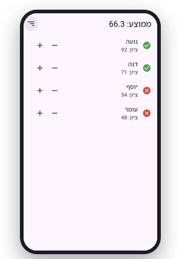

# grades_lab4 — מעקב ציונים

<div dir="rtl">

אפליקציית Flutter פשוטה להצגה ועדכון של ציוני תלמידים. הממשק בעברית, מימין לשמאל, בעיצוב Material 3.

## יכולות

- רשימת תלמידים עם שם וציון.
- כפתורי **+** ו-**−** לשינוי הציון ב-1, בטווח 0–100.
- אייקון ✓ ירוק לציון 60 ומעלה, ✗ אדום לציון נמוך מ-60.
- ממוצע הכיתה בכותרת (ספרה אחת אחרי הנקודה), מתעדכן אוטומטית.
- כפתור מיון בכותרת שמחליף בין מיון יורד לעולה לפי ציון.

## צילום מסך



## הרצה

דרוש [Flutter](https://docs.flutter.dev/get-started/install) מותקן.

```bash
flutter pub get
flutter run
```

להרצת הבדיקות:

```bash
flutter test
```

## מבנה

כל הקוד נמצא בקובץ `lib/main.dart`:

- `GradesApp` (StatelessWidget): הגדרת Material 3 וכיוון RTL.
- `GradesScreen` (StatefulWidget): המסך הראשי. כל שינוי בציון או במיון עובר דרך `setState`, ו-Flutter בונה את המסך מחדש.

</div>
